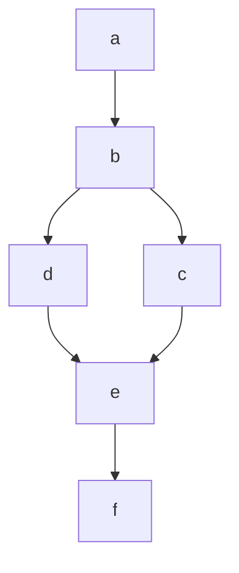
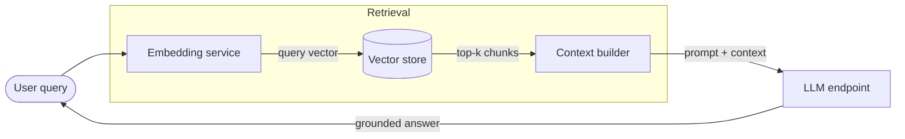

# Mermaid Diagram Readability Skill

## Purpose
Evaluate and improve the readability of Mermaid diagrams embedded in Markdown files so that architects and AI engineers can understand system structure, data flow, and responsibilities quickly and correctly. The skill covers both reviewing existing diagrams and guiding the authoring or refactoring of new ones as diagram-as-code.

## Expertise Areas
- Mermaid diagram types (flowchart, sequence, class, state, entity-relationship, C4, architecture, user journey, mindmap, timeline)
- Diagram-as-code embedded in Markdown (fenced ```mermaid blocks)
- Renderer compatibility (GitHub, GitLab, VS Code, MkDocs Material, Docusaurus, mermaid.live)
- Cognitive load management (chunking, progressive disclosure, overview-plus-detail)
- Layout direction, subgraph grouping, and visual hierarchy
- Node, edge, and participant naming and labeling conventions
- Visual semantics (shapes, line styles, classDef styling, legends)
- Accessibility (accTitle/accDescr, color contrast, color-independent meaning)
- Light/dark theme neutrality
- C4 Model conventions expressed in Mermaid
- AI/agent system diagrams (RAG pipelines, agent-tool topologies, model lifecycle, trust boundaries)

## Review Process

### 0. Diagram Inventory
Before assessing quality, build an inventory of all Mermaid diagrams:
- Find all fenced ```mermaid blocks across Markdown files (for example `grep -rn '```mermaid' --include='*.md' .`)
- Record for each diagram: file, nearest heading, diagram type, node/participant count, edge/message count
- Note Markdown files that describe architecture but contain no diagram (a potential gap, not a defect)
- Note images of diagrams (PNG/SVG screenshots) that have no editable Mermaid or diagram source

### 1. Scope and Diagram-Type Fit
A diagram is readable only if its type matches its intent.

| Intent | Recommended Mermaid Type |
|---|---|
| System context, containers, components (C4) | `C4Context` / `C4Container` / `C4Component`, or `flowchart` with subgraphs per C4 level |
| Process, pipeline, control flow | `flowchart LR` |
| Layered architecture, hierarchy, dependency direction | `flowchart TB` |
| Request/response, agent loop, protocol, tool calls over time | `sequenceDiagram` |
| Lifecycle, session state, workflow status | `stateDiagram-v2` |
| Domain model, knowledge schema, database tables | `erDiagram` or `classDiagram` |
| Deployment/infrastructure topology | `architecture-beta` (check renderer support) or `flowchart` with subgraphs |
| Chronology of decisions or milestones | `timeline` |

**Checklist**
- Does each diagram answer one question (what, how, when, or where — not all at once)?
- Is time-ordered interaction shown as a sequence diagram instead of a flowchart with numbered edges?
- Are static structure and runtime flow separated into different diagrams?
- Are C4 levels kept in separate diagrams (one diagram per zoom level)?

### 2. Complexity and Cognitive Load
- **Flowcharts**: aim for ≤ 20 nodes and ≤ 30 edges; split above that into an overview diagram plus detail diagrams
- **Sequence diagrams**: aim for ≤ 6 participants (hard ceiling ~10) and ≤ 15 messages; extract sub-flows into their own diagrams
- **ER/class diagrams**: aim for ≤ 10 entities per diagram; split by aggregate or bounded context
- ≤ ~7 top-level visual groups (subgraphs) per diagram
- Progressive disclosure: an overview diagram first, linked or followed by detail diagrams, instead of one diagram showing everything
- One level of abstraction per diagram: do not mix business capabilities with class names or infrastructure details

### 3. Layout and Flow Direction
- Declare an explicit direction (`flowchart LR`, `flowchart TB`); never rely on the default silently
- One dominant reading direction per diagram: left→right for pipelines and data flow, top→bottom for layers and hierarchies
- Main path ("happy path") flows in the dominant direction; exceptions and error paths branch off it
- Use `subgraph` blocks for layers, bounded contexts, deployment zones, or trust boundaries — with a human-readable title
- Minimize edge crossings: reorder node declarations, group related nodes, or split the diagram
- Avoid long backward edges; if feedback loops dominate, consider a state or sequence diagram instead

### 4. Labeling and Naming
- Node IDs are for maintainers, labels are for readers: `api[API Gateway]`, not a bare `n1` or `apigw`
- Labels are short noun phrases; add technology in parentheses or brackets when it aids understanding: `vecdb[(Vector DB - pgvector)]`
- Edge labels are short verb phrases of ≤ 4 words: `-->|reads embeddings|`, `-->|publishes event|`
- Label every edge whose meaning is not obvious from context; an unlabeled arrow forces the reader to guess
- No unexplained acronyms: expand on first use in the diagram or the surrounding text
- Quote labels containing special characters (`(`, `)`, `[`, `]`, `{`, `}`, `|`, `#`, `;`) to avoid parse errors: `a["Service (v2)"]`
- Use `<br/>` for intentional line breaks in labels; keep labels to at most 2 lines
- Use `%%` comments in the Mermaid source to explain non-obvious modeling choices to future maintainers

### 5. Visual Semantics
- One shape per concept, used consistently across all diagrams in the repository (for example rectangles = services, cylinders `[( )]` = data stores, stadium `([ ])` = start/end, hexagons = external systems)
- One line style per relationship kind: solid `-->` for synchronous calls or control flow, dotted `-.->` for async/events or optional paths, thick `==>` for the primary path — and keep the convention stable
- Use `classDef` with class assignment for recurring categories instead of styling individual nodes inline
- Color must be redundant, never the only carrier of meaning (color-blind readers, black-and-white printing)
- When shapes, line styles, or colors carry meaning, state the convention in a short legend or a sentence next to the diagram
- Prefer default theme colors; if custom colors are needed, verify contrast of text on fill in both light and dark rendering

### 6. Markdown Integration and Context
- Every diagram has a lead-in: a heading or at least one sentence before the diagram stating what it shows and from which viewpoint
- Place the diagram next to the text it supports, not collected in an appendix far from its explanation
- One idea per diagram; prose carries the reasoning, the diagram carries the structure
- Key takeaways that the diagram should prove are stated in text — the diagram supports the text, it does not replace it
- The Mermaid source lives in the Markdown file (or an included source file), not as a screenshot; exported images are only acceptable when an editable source is linked
- Follow-up references in text use element names exactly as labeled in the diagram

### 7. Rendering and Portability
- Diagrams render in the primary documentation platform (for GitHub: fenced ```mermaid blocks; `click` interactions are disabled; newer diagram types such as `architecture-beta` may lag behind the Mermaid version GitHub bundles — verify before merging)
- Avoid raw HTML in labels beyond `<br/>`; it breaks on stricter renderers
- Use `%%{init: ...}%%` directives sparingly; theme overrides may be ignored or clash with platform dark mode
- Verify every diagram actually parses (mermaid.live, IDE preview, or CI with mermaid-cli); a syntax error renders as an error block and destroys the document's credibility
- Avoid features marked experimental in the Mermaid docs for release-facing documentation unless the renderer version is controlled

### 8. Accessibility
- Provide `accTitle` (short title) and `accDescr` (one- to three-sentence description) for diagrams in release-facing or public documentation
- The surrounding text must allow a reader who cannot see the diagram to still follow the argument
- Meaning never depends on color alone (see Visual Semantics)
- Exported diagram images carry alt text equivalent to the diagram's message

### 9. Maintainability and Currency
- Diagram source is version-controlled with the code and changed in the same pull request as the architecture change it reflects
- Diagrams are reviewed in code review like code
- Shared conventions (shapes, line styles, colors, direction) are documented once, for example in a documentation style guide or the README of the docs folder
- Stale indicators: components in the diagram that no longer exist in the code, or major components in the code missing from the diagram
- Duplicate diagrams of the same view in multiple files are consolidated or clearly marked with a single source of truth

### 10. AI/Agent Architecture Specifics
For diagrams aimed at AI engineers (RAG systems, agents, model pipelines):
- Distinguish **control flow** (who invokes whom) from **data flow** (what moves where — documents, embeddings, prompts, completions); do not overload one arrow style with both
- Make AI-specific components visually distinct and named by role: model/LLM endpoint, prompt template, tool, memory/vector store, orchestrator/agent loop, evaluator/guardrail
- Show trust boundaries (user input, retrieved content, tool output, model output) as subgraphs or boundary markers — this is where prompt-injection and data-leakage review hooks in
- Agent loops and tool-calling protocols are clearest as sequence diagrams with `loop`/`alt` blocks, not as flowcharts with cycles
- Knowledge and retrieval schemas (collections, chunks, metadata) are clearest as ER diagrams
- Name models and versions where they are architecturally relevant, and keep them current

## Readability Example

**Before (hard to read):**


**After (readable):**

The second version declares a direction, names every element by role, labels the data flowing on each edge, groups the retrieval stage, and carries an accessible title and description.

## Output Format

### ✅ Achieved
- Diagrams whose type, size, layout, labeling, and context support fast, correct understanding
- Consistent visual conventions across files
- Accessible, portable, version-controlled diagram sources

### ⚠️ Concerns
- Readable but improvable diagrams (missing edge labels, no lead-in text, inconsistent shapes, oversized but still parseable)
- Renderer-compatibility or theming risks
- Currency doubts (diagram may lag behind the code)

### ❌ Not Achieved
- Diagrams that fail to parse or fail to render on the primary platform
- Diagrams too large or tangled to read (god diagrams, spaghetti edges)
- Meaning carried by color alone, cryptic IDs as labels, or screenshots without source
- Architecture described in text with no diagram where one is clearly needed

### 📊 Diagram Readability Scorecard
| File | Diagram (heading) | Type | Size (nodes/edges) | Type Fit | Layout | Labels | Semantics | Context | Accessibility | Verdict |
|---|---|---|---|---|---|---|---|---|---|---|
| docs/arch.md | "System Overview" | flowchart | 12/16 | ✅ | ⚠️ | ✅ | ✅ | ✅ | ❌ | ⚠️ |

### 💡 Recommendations
For each finding:
- **Priority**: Critical/High/Medium/Low
- **Location**: File and nearest heading (and line number of the ```mermaid fence)
- **Issue**: What harms readability and for whom (architect vs. AI engineer)
- **Action**: Specific change, with a before/after Mermaid snippet for non-trivial rewrites
- **Effort**: Time estimate
- **Benefit**: What understanding the change unlocks

## Key Questions to Answer
1. Can a new architect or AI engineer grasp each diagram's message in under a minute?
2. Does every diagram answer exactly one question at one level of abstraction?
3. Is the diagram type right for the intent (structure vs. flow vs. time vs. state)?
4. Are elements named by role and edges labeled with what flows or happens?
5. Are visual conventions (shapes, line styles, colors, direction) consistent across the repository, and is any non-obvious convention explained?
6. Do all diagrams parse and render on the primary documentation platform, in light and dark mode?
7. Can a reader who cannot see the diagram still follow the document?
8. Are diagrams maintained as code — versioned, reviewed, and in sync with the system?
9. For AI systems: are data flow, control flow, and trust boundaries distinguishable?

## Best Practices
- ✅ **One question per diagram**: overview first, details in separate diagrams
- ✅ **Explicit direction**: `flowchart LR` for flows, `flowchart TB` for hierarchies
- ✅ **Role-based labels**: readers see "API Gateway", maintainers see the ID
- ✅ **Labeled edges**: short verb phrases on every non-obvious arrow
- ✅ **Stable visual grammar**: same shape/line style means the same thing everywhere
- ✅ **Lead-in text**: every diagram introduced by a sentence stating its viewpoint
- ✅ **Subgraphs as boundaries**: layers, contexts, and trust zones made visible
- ✅ **Accessibility built in**: accTitle/accDescr, color never the only signal
- ✅ **Render-verified**: parse-checked and previewed on the target platform before merge
- ✅ **Diagrams as code**: changed in the same PR as the architecture change

## Common Anti-Patterns
- ❌ **God diagram**: one diagram showing every component, layer, and flow at once
- ❌ **Spaghetti edges**: unmanaged crossings and backward arrows obscuring the main path
- ❌ **Cryptic IDs as labels**: `n1 --> svc2` with no human-readable names
- ❌ **Unlabeled arrows**: the reader must guess what flows or triggers
- ❌ **Mixed abstraction levels**: business capabilities, classes, and Kubernetes pods in one picture
- ❌ **Flowchart as timeline**: numbered edges simulating what a sequence diagram shows natively
- ❌ **Color-only meaning**: red/green distinctions with no shape, label, or legend backup
- ❌ **Theme-hostile styling**: hard-coded fills that become unreadable in dark mode
- ❌ **Screenshot diagrams**: rendered images committed without editable source
- ❌ **Decorative diagrams**: diagrams that repeat the text without adding structure
- ❌ **Stale diagrams**: components renamed or removed in code but not in the diagram
- ❌ **Unverified syntax**: committed diagrams that render as Mermaid error blocks
