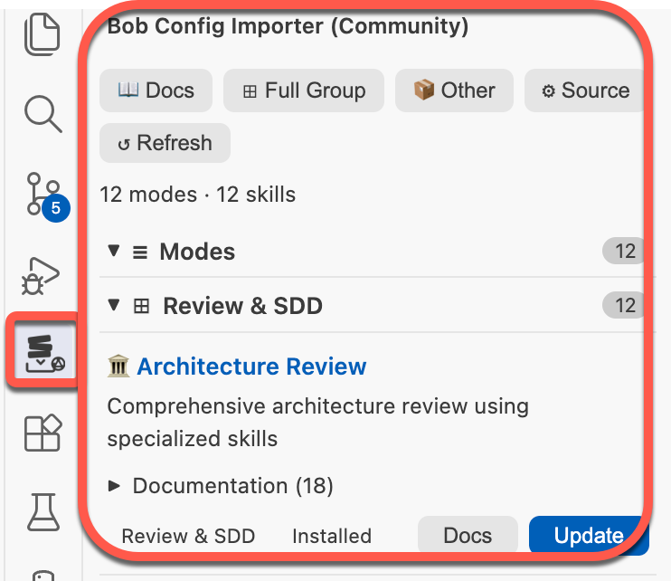

# Bob Config Importer (Community)

> **⚠️ Not affiliated with or supported by IBM.**
> This is a community extension created by Thomas Suedbroecker as a personal
> reference implementation. It is **not** an official IBM product, not endorsed
> by IBM, and not supported by IBM. IBM Bob is a trademark of IBM Corporation.
> Use this extension at your own risk.

VS Code extension that installs custom **modes**, **skills**, **hooks**, and
**other configurations** (scripts, MCP configuration, guides) from a
`bob_config_collection` into the `.bob/` folder of an IBM Bob workspace.
Hooks are also registered: their entries from the collection's
`hooks/hooks.json` are merged into the workspace's `.bob/settings.json`.

By default it loads the collection from the public GitHub repository
[thomassuedbroecker/review_and_sdd_custom_ibm_bob_configuration_template](https://github.com/thomassuedbroecker/review_and_sdd_custom_ibm_bob_configuration_template).
You can point it at your own repository created from that template, use the
collection bundled with the extension (offline), or use a local folder.



## Sidebar panel

After installation a **Bob Config Importer** icon appears in the VS Code /
IBM Bob activity bar (left-hand icon strip). Click it to open the catalog panel,
which shows all available modes, skills, and hooks as cards — grouped, with tag
pills and an **Install** button per item — plus a toolbar for the remaining
commands. No Command Palette required.

## Commands

All actions are also reachable via the Command Palette (category **Bob Config**):

- **Read Mode, Skill, or Hook Documentation…**: read any mode, skill, or hook without installing it
- **Import Modes…**: pick modes; the skills they reference can be installed too
- **Import Skills…**: pick skills
- **Import Hooks…**: pick lifecycle hooks; the script goes to `.bob/hooks/` and its registration is merged into `.bob/settings.json`
- **Import Other Configurations…**: scripts, MCP servers, guides, diagrams, images
- **Import Complete Mode Group…**: everything of one mode group
- **Select Collection Source…** / **Refresh Collection**

In the mode, skill, and hook pickers, select the **book icon** next to an entry
to read its documentation in a Markdown preview before you install it.

The collection is the leading configuration. Existing modes with the same slug
and files with the same path are replaced after you confirm.

## Download a prebuilt version

> Use at your own risk. Read [Disclaimer and license](#disclaimer-and-license)
> before installing.

Prebuilt `.vsix` files are attached to the
[GitHub Releases](https://github.com/thomassuedbroecker/review_and_sdd_custom_ibm_bob_configuration_template/releases)
of this repository. The Releases page is also the version history: every
release keeps its own `.vsix` file.

1. Download `bob-config-importer-<version>.vsix` and
   `bob-config-importer-<version>.vsix.sha256` from a release.
2. Verify the file:

   ```bash
   shasum -a 256 -c bob-config-importer-<version>.vsix.sha256
   ```

3. Install it with **Extensions: Install from VSIX…** from the Command Palette,
   or run:

   ```bash
   code --install-extension bob-config-importer-<version>.vsix
   ```

The `.vsix` is not code-signed and not published on the VS Code Marketplace,
so VS Code does not update it automatically. Download a newer release to update.

## Generate the extension (.vsix)

Prerequisites: Node.js ≥ 22 and npm. The packaging tools (`@vscode/vsce`
and its Azure dependencies, `sharp`) require Node.js 22.

```bash
cd bob_config_collection/code
npm install          # once: installs the packaging tool @vscode/vsce
npm test             # optional: all tests must pass
npm run package      # validates and bundles the collection, then packages
```

Result: `bob_config_collection/code/dist/bob-config-importer-<version>.vsix`
(the version comes from `package.json`).

Run **Extensions: Install from VSIX…** from the Command Palette and select
the file. The `.vsix` contains the collection as it was when you packaged it
(source **bundled**). By default, the extension still loads the latest
collection from GitHub. Details: [docs/build-and-test.md](docs/build-and-test.md).

## Folder structure

| Folder | Content |
|---|---|
| `src/` | Extension and tooling code (`extension.js`, `lib/`, `config/`, `tools/`) |
| `docs/` | Documentation: [usage](docs/usage.md), [build and test](docs/build-and-test.md), [architecture](docs/architecture.md) |
| `test/` | Unit and integration tests (`npm test`) |

## Disclaimer and license

This extension is licensed under the [Apache License 2.0](LICENSE). It is
provided "AS IS", WITHOUT WARRANTIES OR CONDITIONS OF ANY KIND (section 7 of
the license), and the authors are not liable for damages arising from its use
(section 8), to the extent permitted by applicable law. You use the extension,
whether built from source or downloaded as a prebuilt `.vsix`, at your own risk.

What the extension does on your system:

- **Writes files** into your workspace's `.bob/` folder. Existing modes with
  the same slug and files with the same path are replaced after you confirm.
- **Merges hook entries** into `.bob/settings.json`. **Imported hooks and
  scripts run code on your machine.** Read them with **Read Mode, Skill, or
  Hook Documentation…** before you install them.
- **Downloads content from GitHub** when the source is `github` (the default).
  If you point `bobConfigImporter.githubRepository` at another repository, you
  trust that repository's content.

No support, maintenance, or updates are guaranteed. Report problems through
[GitHub Issues](https://github.com/thomassuedbroecker/review_and_sdd_custom_ibm_bob_configuration_template/issues).

This is a community project. It is not affiliated with, endorsed by, or
supported by IBM. IBM Bob is a trademark of IBM Corporation.
