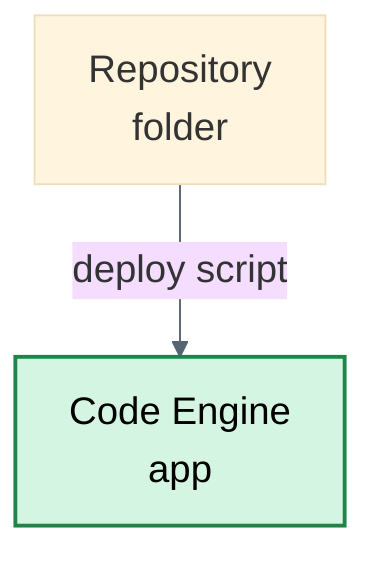

# Skill: mermaid-readable-diagrams

Makes every Mermaid diagram that Bob writes in a `.md` file readable on
GitHub and on a printout (PDF, A4/Letter, black-and-white), without any
external diagram tool.

The instructions Bob follows are in [`SKILL.md`](SKILL.md). This README
describes the skill for humans.

## Why this skill exists

Mermaid diagrams are easy to write and easy to get unreadable: too many
nodes, a tiny default font, long left-to-right chains that shrink on a page,
and colour-only meaning that disappears when printed in grey-scale. No other
skill in `.bob/skills/` covers diagram authoring.
[`sdd-documentation-review`](../sdd-documentation-review/SKILL.md) only
names Mermaid as a tool.

The conventions are visible in
[`docs/m4-new-product-onboarding.md`](../../../docs/m4-new-product-onboarding.md).

## When Bob uses it

- You ask for a diagram (architecture, flow, sequence, ER, state) in a `.md` file.
- You edit or review an existing ```` ```mermaid ```` block.
- You say a diagram is too small, too wide, too crowded, or does not print well.
- You prepare a document for PDF export or printing.

## What it enforces

| Area | Rule |
|---|---|
| Size | About 12 nodes or fewer per diagram; split larger ones (6a, 6b) |
| Labels | Short, at most 3 lines; details go into a table below the diagram |
| Font | First line of each block is a `%%{init …}%%` preset with an 18-22px font |
| Direction | `TD` by default; `LR` only for 5 nodes or fewer in a row |
| Print | Light fills, black text, meaning also shown by border style and label words |
| GitHub | Quoted labels, short ASCII ids, `flowchart`, no beta diagram types or icons |
| Context | Numbered heading, question sentence, legend, text companion, dated status table |
| Validation | Optional syntax check with `@mermaid-js/mermaid-cli`; otherwise Bob states it was not machine-validated |

## Example result

A block produced under this skill starts like this:

````markdown
## 3. Repository to runtime mapping (static)

Which folder ends up where?



| Part | State 2026-11-04 |
|---|---|
| Code Engine app | Deployed |
````

## Usage

Ask in plain language, for example:

- "Add a sequence diagram for the evidence upload flow to `docs/m4-new-product-onboarding.md`."
- "Make the diagram in section 5 printable."
- "Split diagram 2 so it fits on one page."

No configuration is needed. Bob loads the skill from its `description`
in the front matter of `SKILL.md`.

## Files

| File | Purpose |
|---|---|
| [`SKILL.md`](SKILL.md) | Instructions for Bob: rules, workflow, checklist, anti-patterns |
| `README.md` | This description |

## Limits

- GitHub's Mermaid version lags behind the latest release; new diagram types
  may not render there.
- The skill does not produce image files (PNG/SVG). The diagram source stays
  in the `.md` file.
- The reference links in `SKILL.md` were not re-verified online when the
  skill was written.

## References

- [Mermaid directives (init)](https://mermaid.js.org/config/directives.html)
- [Mermaid theming](https://mermaid.js.org/config/theming.html)
- [GitHub Docs: Creating diagrams](https://docs.github.com/en/get-started/writing-on-github/working-with-advanced-formatting/creating-diagrams)
- [WCAG 2.2, 1.4.1 Use of Color](https://www.w3.org/TR/WCAG22/#use-of-color)
